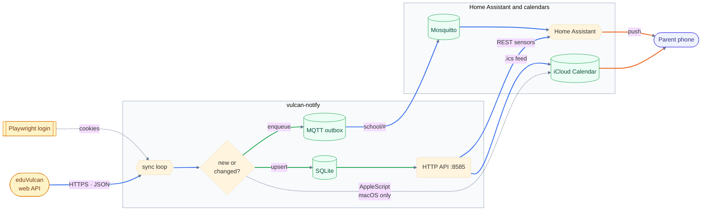

# vulcan-notify

> [!TIP]
> ***Push notifications, calendars, and dashboards from the eduVulcan school e-journal.***

Syncs the eduVulcan web API to a local SQLite database and diffs each run against the last one. Any changes go out to the terminal, macOS Calendar, MQTT, and an HTTP/iCalendar API, so Home Assistant (or anything else) can react to school events as they happen.

**Tracks** grades, attendance, exams, homework, messages (with an optional sender whitelist), and lesson substitutions/cancellations. It handles multiple students under one parent account.

**Exposes** terminal output, macOS Calendar events, MQTT events with a persistent outbox, a JSON API on `:8585`, a per-student `.ics` feed, and optional AI digests via any OpenAI-compatible API.

## How it works



1. **Auth** - log in once in a Playwright browser to save session cookies. If credentials are stored, the tool renews expired sessions headlessly.
2. **Fetch** - call the eduVulcan web API with those cookies: grades (all periods), attendance (last 90 days), exams, homework, messages, and the schedule.
3. **Diff and persist** - compare against SQLite and upsert with `INSERT OR REPLACE`. Exams and homework that drop out of the API are soft-deleted. The first sync stores a baseline and reports nothing.
4. **Publish** - print changes, write them to macOS Calendar, and drain the MQTT outbox to the broker. The outbox survives broker outages.
5. **Serve** - a separate long-running process (`python -m vulcan_notify.api`) serves HTTP and iCalendar from the same SQLite file.

Module breakdown, schema, MQTT topic map, and endpoint reference: [`docs/architecture.md`](docs/architecture.md).

## Installation

Requires Python 3.12+ and [uv](https://docs.astral.sh/uv/).

```bash
git clone https://github.com/kintecus/vulcan-notify.git
cd vulcan-notify
uv sync
uv run playwright install chromium

cp .env.example .env            # optional, see Configuration
uv run vulcan-notify auth       # opens a browser
uv run vulcan-notify sync
```

## Commands

| Command | Description |
|---------|-------------|
| `vulcan-notify auth` | Browser login, saves session cookies |
| `vulcan-notify test` | Check whether the saved session is valid |
| `vulcan-notify sync` | Fetch, diff, and publish changes (default) |
| `vulcan-notify heartbeat` | Publish the retained MQTT heartbeat only, no sync |
| `vulcan-notify calendar` | Force a clean re-sync of macOS Calendar events |
| `vulcan-notify tui` | Textual browser for synced content (`uv sync --extra tui`) |
| `vulcan-notify summarize [--type sync\|messages] [--days N]` | AI digest of recent changes or messages (needs `LLM_API_KEY`) |

## Home Assistant

In production, vulcan-notify runs in Docker on a Proxmox LXC as two services: the sync loop and the API. It publishes to the Mosquitto add-on in Home Assistant OS.

- **MQTT (event-driven)** - topics follow `<prefix>/<student>/<segment>/<change_type>`, e.g. `school/alice/grades/new` or `school/alice/substitutions/new`, with JSON payloads. A retained `school/status` heartbeat with an LWT lets HA detect a silent daemon.
- **HTTP (pull-based)** - REST sensors poll `/api/grades/monthly`, `/api/messages`, `/api/schedule`, and others. `/api/health` returns 503 when data goes stale, and quiet hours don't count toward staleness. Any calendar client can subscribe to `/calendar/<name>.ics`.

Setup: [`docs/deployment.md`](docs/deployment.md).

## Auto-login

eduVulcan sessions expire after a few hours. For unattended runs, store your credentials and `sync` will re-authenticate headlessly. The macOS Keychain keeps them off disk:

```bash
security add-generic-password -s vulcan-notify -a your.email@example.com -w
```

Or set `VULCAN_LOGIN` and `VULCAN_PASSWORD` in `.env`.

## Calendar

Map each student to an existing macOS calendar:

```
CALENDAR_MAP={"Alice Smith": "School Alice", "Bob Johnson": "School Bob"}
```

`sync` then writes exams and homework as all-day events with an alarm, and iCloud syncs them to your other devices. Event UIDs are stored in the database for deduplication. Soft-deleted items also lose their events.

## Configuration

Set these as environment variables or in `.env`.

| Variable | Default | Description |
|----------|---------|-------------|
| `DB_PATH` | `vulcan_notify.db` | SQLite database path |
| `SESSION_FILE` | `session.json` | Saved session cookies |
| `VULCAN_LOGIN` / `VULCAN_PASSWORD` | (none) | Credentials for headless re-auth |
| `SYNC_ATTENDANCE_DAYS` | `90` | Attendance lookback window |
| `SYNC_MESSAGE_BACKFILL_BATCH` | `10` | Legacy message bodies to refetch per run |
| `SYNC_HISTORY_KEEP_DAYS` | `90` | Retention for sync run history |
| `POLL_INTERVAL` | `1800` | Seconds between syncs in the service loop |
| `QUIET_HOURS_START` / `QUIET_HOURS_END` | `0` / `5` | Hours (0-23) when syncing pauses |
| `QUIET_HOURS_TZ` | `Europe/Warsaw` | Time zone for the quiet window (the container stays on UTC) |
| `STALE_AFTER_SECONDS` | `3600` | Data age at which `/api/health` reports stale |
| `MESSAGE_SENDER_WHITELIST` | (empty) | Comma-separated sender names, empty shows all |
| `DISPLAY_NAME_MAP` | (empty) | JSON map of full name to nickname for notification titles |
| `CALENDAR_MAP` | (empty) | JSON map of student name to macOS calendar |
| `CALENDAR_REMINDER_HOURS` | `24` | Alarm lead time |
| `MQTT_ENABLED` | `false` | Enable MQTT publishing |
| `MQTT_BROKER` / `MQTT_PORT` | `localhost` / `1883` | Broker address |
| `MQTT_USERNAME` / `MQTT_PASSWORD` | (none) | Broker auth |
| `MQTT_TOPIC_PREFIX` | `school` | Topic root |
| `MQTT_STATUS_SUFFIX` | `status` | Retained heartbeat topic under the prefix |
| `LLM_BASE_URL` | `https://api.cerebras.ai/v1` | OpenAI-compatible endpoint for summaries |
| `LLM_API_KEY` | (none) | Enables summaries |
| `LLM_MODEL` | `gpt-oss-120b` | Summary model |
| `PROMPTS_FILE` | `prompts.toml` | Summary prompt templates |
| `NTFY_TOPIC` / `NTFY_SERVER` | `vulcan-notify` / `https://ntfy.sh` | ntfy target for deploy notifications |
| `LOG_LEVEL` | `INFO` | Logging level |

## Documentation

- [`docs/architecture.md`](docs/architecture.md) - pipeline, schema, MQTT payloads, endpoints
- [`docs/deployment.md`](docs/deployment.md) - Docker, Proxmox LXC, and systemd
- [`docs/eduvulcan-api.md`](docs/eduvulcan-api.md) - reverse-engineered eduVulcan web API reference
