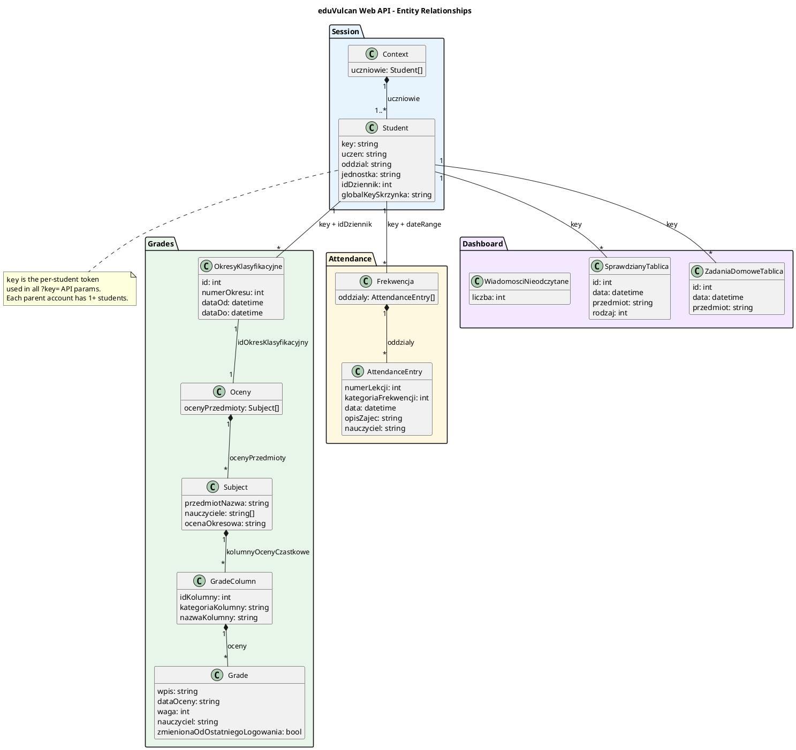

# eduVulcan web API reference

Reverse-engineered from the `uczen.eduvulcan.pl` SPA (March 2026).

## Authentication

The web API uses ASP.NET session cookies. No JWTs involved - the auth flow is WS-Federation (SAML XML tokens) between three domains:

1. `eduvulcan.pl` - main portal, handles login
2. `dziennik-logowanie.vulcan.net.pl/{tenant}` - federation service, issues security tokens
3. `uczen.eduvulcan.pl/{tenant}` - student dashboard, consumes tokens and sets session cookies

Key cookies for API access:
- `ASP.NET_SessionId` (on `uczen.eduvulcan.pl`)
- `Eduvulcan.Uczen.Sso` + `Eduvulcan.Uczen.Sso1` (XML security context tokens, split across two cookies)
- `X-V-RequestVerificationToken#...` (CSRF-like token)

The `tenant` is the school district identifier extracted from the dashboard URL (e.g. `exampledistrict`).

**Important:** the iris library's `register_by_jwt` endpoint expects JWTs, but eduVulcan no longer provides them through the web login flow. This project uses saved browser cookies instead.

## Base URL

```
https://uczen.eduvulcan.pl/{tenant}/api/
```

## Student context

### GET /api/Context

Returns all students linked to the logged-in parent account.

```json
{
  "uczniowie": [
    {
      "key": "BASE64_ENCODED_STUDENT_KEY",
      "uczen": "Jan Kowalski",
      "oddzial": "3A",
      "jednostka": "Szkola Podstawowa nr 1",
      "idDziennik": 1001,
      "idJednostkaSkladowa": 1,
      "globalKeySkrzynka": "aaaaaaaa-bbbb-cccc-dddd-eeeeeeeeeeee",
      "aktywny": true,
      "opiekunUcznia": true
    }
  ]
}
```

The `key` field is the per-student token used as `?key=` parameter in all subsequent API calls. Each parent account can have multiple students.

## Grades

### GET /api/OkresyKlasyfikacyjne?key={key}&idDziennik={idDziennik}

Returns classification periods (semesters). Required before fetching grades.

```json
[
  {"id": 1001, "numerOkresu": 1, "dataOd": "2025-09-01T...", "dataDo": "2026-01-31T..."},
  {"id": 1002, "numerOkresu": 2, "dataOd": "2026-02-01T...", "dataDo": "2026-08-31T..."}
]
```

### GET /api/Oceny?key={key}&idOkresKlasyfikacyjny={periodId}

Returns all grades for a student in a given period. Grouped by subject.

```json
{
  "ocenyPrzedmioty": [
    {
      "przedmiotNazwa": "Edukacja wczesnoszkolna",
      "pozycja": 1,
      "nauczyciele": ["Nowak Anna [AN]"],
      "srednia": null,
      "ocenaOkresowa": " ",
      "proponowanaOcenaOkresowa": " ",
      "kolumnyOcenyCzastkowe": [
        {
          "idKolumny": 100001,
          "kategoriaKolumny": "Biezace",
          "nazwaKolumny": "Sprawdzian 1",
          "oceny": [
            {
              "wpis": "5p",
              "dataOceny": "26.01.2026",
              "waga": 1,
              "kolorOceny": 0,
              "nauczyciel": "Nowak Anna [AN]",
              "zmienionaOdOstatniegoLogowania": false,
              "idOcenaPoprawiona": null
            }
          ]
        }
      ]
    }
  ]
}
```

Grade structure: `Oceny -> Subject -> GradeColumn -> Grade`. The `zmienionaOdOstatniegoLogowania` flag indicates whether a grade changed since the last login - useful for change detection.

## Attendance

### GET /api/Frekwencja?key={key}&dataOd={isoDate}&dataDo={isoDate}

Returns attendance records for a date range. Dates are ISO 8601 with timezone offset.

```json
{
  "oddzialy": [
    {
      "idPoraLekcji": 37,
      "numerLekcji": 5,
      "kategoriaFrekwencji": 1,
      "data": "2026-03-09T00:00:00+01:00",
      "opisZajec": "Przyroda",
      "nauczyciel": "Wisniewski Tomasz",
      "godzinaOd": "2026-03-09T11:45:00+01:00",
      "godzinaDo": "2026-03-09T12:30:00+01:00"
    }
  ]
}
```

`kategoriaFrekwencji` values (observed): 1 = present, 2 = absent. Other values (late, excused) need further observation.

### GET /api/FrekwencjaStatystyki?key={key}&idPrzedmiot={id}

Attendance statistics. Use `idPrzedmiot=-1` for all subjects. Not synced.

```json
{
  "podsumowanie": 97.3,
  "statystyki": [
    {"kategoriaFrekwencji": 1, "razem": 412, "okresy": [210, 202], "miesiace": [{"miesiac": 9, "wartosc": 80}]}
  ]
}
```

`statystyki` has one entry per attendance category, and categories 1 through 7 all appear (observed 2026-10-27). That is the full set `kategoriaFrekwencji` can take; only 1-4 are mapped so far (see Open questions).

### GET /api/Usprawiedliwienia?key={key}&dataOd={isoDate}&dataDo={isoDate}

Excuse requests for the given date range. Synced into `excuses`; a status change is published.

```json
{
  "usprawiedliwienia": [
    {
      "idUsprawiedliwienieDzien": 1234,
      "idUsprawiedliwienieDzienPoraLekcji": 5678,
      "dzien": "2026-10-01T00:00:00+02:00",
      "idPoraLekcji": 3,
      "numerLekcji": 3,
      "poczatekLekcji": "2026-10-01T09:50:00+02:00",
      "koniecLekcji": "2026-10-01T10:35:00+02:00",
      "status": 1
    }
  ],
  "usprawiedliwieniaAktywne": true,
  "usprawiedliwieniaBlokada": {"dataOd": null, "dataDo": null, "obowiazujeDo": null, "oddzialy": {}}
}
```

The lesson fields (`idPoraLekcji`, `numerLekcji`, `poczatekLekcji`, `koniecLekcji`) are all `null` for a whole-day excuse. Only `status: 1` has been observed; its meaning is unconfirmed.

## Dashboard summaries (Tablica endpoints)

These are lightweight endpoints used by the dashboard. Good for polling since they return minimal data.

### GET /api/OcenyTablica?key={key}

Recent grade changes. Returns `[]` when no recent changes.

### GET /api/FrekwencjaTablica?key={key}

Recent attendance changes.

```json
{
  "oddzialy": [...],
  "dziennikiZajecInnych": []
}
```

### GET /api/SprawdzianyTablica?key={key}

Upcoming exams/tests.

```json
[
  {"id": 10001, "data": "2026-03-16T...", "przedmiot": "Przyroda", "rodzaj": 2}
]
```

`rodzaj`: 1 = test (sprawdzian), 2 = quiz (kartkowka) - needs verification.

### GET /api/SprawdzianSzczegoly?key={key}&id={examId}

Exam detail. Returns description and teacher.

```json
{
  "typ": 2,
  "data": "2026-03-23T00:00:00+01:00",
  "przedmiotNazwa": "Język polski",
  "nauczycielImieNazwisko": "Agnieszka Kochanowska-Sabljak",
  "opis": "Test ze znajomości lektury \"Mikołajek\".",
  "id": 43431
}
```

### GET /api/ZadaniaDomoweTablica?key={key}

Upcoming homework.

```json
[
  {"id": 10002, "data": "2026-03-16T...", "przedmiot": "Plastyka"}
]
```

### GET /api/ZadanieDomoweSzczegoly?key={key}&id={homeworkId}

Homework detail. Returns description, teacher, attachments, and student response status.

```json
{
  "typ": 4,
  "data": "2026-03-16T00:00:00+01:00",
  "terminOdpowiedzi": "2026-03-16T00:00:00+01:00",
  "przedmiotNazwa": "Plastyka",
  "nauczycielImieNazwisko": "Paulina Studnicka",
  "opis": "Na plastykę proszę przynieść blok rysunkowy...",
  "zalaczniki": [],
  "linki": [],
  "status": 0,
  "odpowiedzWymagana": false,
  "zadanieModulDydaktyczny": false,
  "odpowiedz": {
    "id": 642123,
    "status": 1,
    "odpowiedz": null,
    "komentarzNauczyciela": null,
    "zalaczniki": [],
    "data": null
  },
  "id": 36511
}
```

### GET /api/SprawdzianyZadaniaDomowe?key={key}&dataOd={isoDate}&dataDo={isoDate}

Calendar view combining exams and homework, used by the "Sprawdziany i zadania domowe" page. **`dataOd`/`dataDo` are required**: without them it returns HTTP 404, which is easy to misread as the endpoint being gone. Not synced.

```json
[{"id": 123, "typ": 1, "przedmiotNazwa": "Matematyka", "data": "2026-11-03T00:00:00+01:00", "hasAttachment": false}]
```

### GET /api/WiadomosciNieodczytane

Unread message count (not per-student, account-level).

```json
{"liczbaWiadomosciNieodczytanych": 214}
```

### GET /api/OgloszeniaTablica?key={key}

Announcements. Returns `[]` when none, and has never returned an item for this account, so the item schema is unknown. Synced into `feed_items` with the raw JSON kept; drift detection learns the real shape on the first item.

### GET /api/UsprawiedliwieniaTablica?key={key}

Excuse overview. Same top-level keys as `Usprawiedliwienia` but no date range, and `usprawiedliwieniaBlokada` is `null` rather than an object.

### GET /api/WychowawcyTablica?key={key}

Homeroom teachers.

```json
[{"imieNazwisko": "Nowak Maria", "isGlowny": true, "globalKeySkrzynka": "..."}]
```

### GET /api/Uwagi?key={key}

Behaviour notes (remarks). Returns `[]` when none. Like announcements, it has never returned an item, so it is synced into `feed_items` with the raw JSON kept. The SPA's page for this is `PochwalyUwagi` (praise and remarks), so praise may live on a separate endpoint not yet identified.

## Other endpoints

### GET /api/PoryLekcji?key={key}

Lesson time slots for the school.

### GET /api/Przedmioty?key={key}

List of subjects.

### GET /api/DniWolne?key={key}&dataOd={isoDate}&dataDo={isoDate}

School holidays and closures. Synced into `days_off` for the current school year; a new entry is published.

```json
[
  {
    "nazwa": "Ferie zimowe",
    "dataOd": "2027-01-18T00:00:00+01:00",
    "dataDo": "2027-01-31T00:00:00+01:00",
    "wszystkieSkladowe": true,
    "jednostkiSkladowe": [{"id": 12, "nazwa": "Szkoła Podstawowa"}]
  }
]
```

### GET /api/PlanZajecTablica?key={key}

Today's schedule. Returns a list of lesson dicts (see `PlanZajec` below for field details). Despite accepting `data=` / `dataOd=` / `dataDo=` query params, it **ignores them** and always returns the current day. Use `PlanZajec` for any range other than today.

### GET /api/PlanZajec?key={key}&dataOd={isoDatetimeUtc}&dataDo={isoDatetimeUtc}&zakresDanych=2

Schedule across a date range — the endpoint used by the web app's "Plan zajęć" week/month view. Includes substitutions (`zastępstwa`).

- `dataOd` / `dataDo`: full ISO-8601 UTC datetimes (e.g. `2026-03-31T22:00:00.000Z`), framing local-time midnight-to-midnight in Europe/Warsaw.
- `zakresDanych=2`: required; the web app always sends 2 for this view.

Response: list of lesson dicts with keys:

- `data` / `godzinaOd` / `godzinaDo` — local-timezone ISO datetimes
- `prowadzacy`, `prowadzacyWspomagajacy1`, `prowadzacyWspomagajacy2` — teacher + up to two assistants
- `przedmiot` — subject name
- `podzial` — group label (e.g. `BS` for pool group), nullable
- `sala` — room
- `pseudonim` — nullable nickname
- `adnotacja` — int flag; non-zero means the lesson has changes/annotations
- `dodatkowe` — bool; extra/added lesson
- `zrealizowane` — bool; lesson already took place
- `idJednostkaSkladowa` — school unit id
- `zmiany` — list of substitution entries (empty when no change):
  - `zmiana` — change type code (e.g. 7 for teacher swap)
  - `typProwadzacego` — teacher-type flag
  - `prowadzacy` — replacement teacher name
  - `sala` — replacement room (may be empty string)
  - `dzien`, `nrLekcji`, `godzinaOd`, `godzinaDo`, `grupa`, `zajecia`, `informacjeNieobecnosc` — nullable overrides for reschedules/absences
- `zmianyUwagi` — list of free-text remarks about the change

### GET /api/KomunikatStartowy

Startup notice. Returns `[]` for this account; schema unknown. Not synced.

System-wide announcements. Returns `[]` when none.

## Entity relationships



![eduVulcan Web API Entity Relationships](https://www.plantuml.com/plantuml/svg/fLPBQzj04BxlhrZKMq92JL983QK9iLr2GbpYqa1A3wFTYRsMj2kqArofvBztzFJALauzIPxvvltDoDVMGURo96PEkHWvolnd7WlG_1b3VlFzZf_nkIPTmPym1gUCjXkLMcOZfLF88E4Y1cjldCjKc3ky4qQlL8dyuo5aORIhDPCBJvM2Y62DU-KbsoX9YIGfnKpGROoqZBKm7gpGMaeYu1_cLulBnOp_PRpnps_91_vnjOJpN9HQcPt2AL-vNA9sltwJuetr-5RSuYCifjnI5NhTsQCUI8oKfO9u8DkYrCQw20PI9MUbGgrLDELAkrgsZaq8yJqMgoWh2psmU6DlNedVCf1ecme_pJzx5IwZ36rnJ-_5guf055kDRVfAxaFfFC6inkPxeGG7ImBH4vrAi1VEp43eDMWfK1UjVrEzVyzAb8aoZbgroiCjYkEcDkBMAkqC7g7S3NkaWJfS28KnTlBQLnCAwlJDRjYbFahTebiJvudkwx-lVnRxYYCgQcqo1Rrc49uIEbOSncYzxr9b1-PrDwkM3AGxM8CtXhx20QXCY1f4OPh6ahRFQKLPFfWr5QiLcOV6n4USeFr2BK4B95ui5ekh-SJZnIB3Q8TQRA6RLaDLocvlI6kS5OVZEb2tvZM17Z0IMpNIpZwQ6hBhW5k6UlO2H8Ptnluk_sTWDw61J5QbNj0I-4k-IZFOLSNfuWU4iH8miW0ZsVHC76IJ6Ld2jZFq-l82ifh6p2HcX_yTo7Fyh42IKolKeq8ZgHSE-YMcA6K8-tJ8hZjgmIJW9sTdz3m_FmdwspNTtpdMoIfeXIJOwC6OLhUEdtfNYetYEZ_qQ2u19IPhv01Oi4RRPrYbrrw1wU7TO9t6H_lRJCarIraxlIs1ZYkDWFcO8zikpbWBlDte2g_czGHwZSnJ-auFjsBQBzHOX15Arf76iAEyQj1C6uUq_SwPX9lNRiH4X20WVH1mPRdR84ynExEjQsSYr0J9BKgY3OSuvby9_QN-TjUVM7jE-Zc8JVMpiW4XJ4xF3LW-EUMjAu9HpRnAWbtJ6_qd-0S0)

## Messages (separate subdomain)

Messages live on `wiadomosci.eduvulcan.pl/{tenant}/api/`, not on the main `uczen.eduvulcan.pl` domain. The inbox is unified across all students - the `skrzynka` field on each message indicates which child's mailbox it belongs to.

### GET /api/Skrzynki

Returns mailboxes for all students. The `globalKey` matches `globalKeySkrzynka` from the Context endpoint.

```json
[
  {"globalKey": "aaaaaaaa-...", "nazwa": "Parent Name - R - Child Name - (School)", "typUzytkownika": 2},
  {"globalKey": "bbbbbbbb-...", "nazwa": "Parent Name - R - Other Child - (School)", "typUzytkownika": 2}
]
```

### GET /api/LiczbyNieodczytanych

Unread count per mailbox.

```json
[
  {"globalKey": "aaaaaaaa-...", "liczbaWiadomosci": 150},
  {"globalKey": "bbbbbbbb-...", "liczbaWiadomosci": 64}
]
```

### GET /api/Odebrane?idLastWiadomosc={lastId}&pageSize={n}

Received messages, newest first. Use `idLastWiadomosc=0` for the first page. Passing a message id returns that message and older ones: **the cursor is inclusive**, so consecutive pages overlap by exactly one message. Paging goes back through the whole inbox (more than 740 messages here, confirmed 2026-10-27).

```json
[
  {
    "id": 379162,
    "apiGlobalKey": "646d3311-...",
    "korespondenci": "Nowak Anna - P - (School)",
    "temat": "Message subject",
    "data": "2026-03-15T11:02:41.183+01:00",
    "skrzynka": "Parent Name - R - Child Name - (School)",
    "hasZalaczniki": false,
    "przeczytana": false,
    "wazna": false,
    "uzytkownikRola": 2,
    "wycofana": false,
    "odpowiedziana": false,
    "przekazana": false
  }
]
```

### GET /api/WiadomoscSzczegoly?apiGlobalKey={uuid}

Full message detail including HTML content.

```json
{
  "id": 379162,
  "apiGlobalKey": "646d3311-...",
  "nadawca": "Nowak Anna - P - (School)",
  "odbiorcy": ["Parent Name - R - Child Name - (School)"],
  "temat": "Message subject",
  "tresc": "<p>HTML message content</p>",
  "data": "2026-03-15T11:02:35+01:00",
  "odczytana": false,
  "zalaczniki": []
}
```

### GET /api/Cache

Shared configuration for the messages app.

### GET /api/Stopka

Email signatures per mailbox.

## SPA feature inventory

The SPA bundle (`uonetplus-cdn.vulcan.net.pl/AppCdn/EduVulcanUczen/Scripts/prodbundle_<version>.js`, version `26_7_1_67022` on 2026-10-27) is obfuscated: endpoint paths are assembled from a string table at runtime, so grepping it for `/api/` paths finds nothing. Its view and store names are readable, though, and list every page the app has:

| View | Synced | Notes |
|------|--------|-------|
| View | Endpoint(s) | Synced |
|------|-------------|--------|
| `Oceny`, `Frekwencja`, `PlanZajec`, `Tablica` | see above | yes |
| `SprawdzianyZadaniaDomowe` | `SprawdzianyZadaniaDomowe` (needs dates) | no (exams and homework come from the `*Tablica` endpoints) |
| `PochwalyUwagi` | `Uwagi` | yes (schema unknown) |
| `Zebrania` | `Zebrania` | no |
| `Osiagniecia` | `Osiagniecia` | no |
| `Frekwencja` (reported absences) | `ZgloszoneNieobecnosci`, `ZglaszanieNieobecnosciKonfiguracja` | no |
| `Jadlospis` | `Jadlospis` (dates), `JadlospisTablica` | no |
| `SzkolaInformacje` | `Informacje` | no |
| `SzkolaNauczyciele` | `Nauczyciele` | no |
| `SzkolaFormularze` | `FormularzeSzablony`, `FormularzWysylanie` | no |
| `SzkolaOplaty` | `Oplaty` | no, deliberately: carries bank account numbers |
| `EwidencjaObecnosci`, `RealizacjaZajec` | not reached: no menu entry for this school | no |

Endpoints were identified on 2026-10-27 by driving the SPA in Chrome with Playwright and recording `/api/` traffic (paths, parameter names, and response structure only). Logging in from a separate browser does not disturb an existing session; the production session stayed valid throughout.

### Endpoints found by the browser session

Parameters are `key` only unless listed. Shapes are observed structure; examples are illustrative.

| Endpoint | Shape | Notes |
|----------|-------|-------|
| `Zebrania` | `[{id, dataCzas, temat, agenda, sala, obecniNaZebraniu, zebranieOnline}]` | Parent-teacher meetings. Had real entries |
| `SzczesliwyNumerTablica` | `{id, numer}` | Today's "lucky number" (the student with this register number is exempt from being called on). The SPA also POSTs to it (204) |
| `WazneDzisiajTablica` | `[]` | "Important today". Empty so far |
| `EgzaminyKoncoweTablica` | `[]` | Final exams. Empty so far |
| `AnkietyTablica` | `[]` | Surveys. Empty so far |
| `InformacjeTablica` | `[]` | Dashboard notices. Empty so far |
| `DyzurniTablica` | `[{id, imie, nazwisko}]` | Students on duty |
| `ZdjecieTablica` | `{status}` | Student photo status |
| `Osiagniecia` | `[]` | Achievements. Empty so far |
| `ZgloszoneNieobecnosci` | `[]`; params `dataOd`, `dataDo` | Absences reported by the parent |
| `ZglaszanieNieobecnosciKonfiguracja` | `{rodzicMozeZglaszac, dniPrzed, doGodziny, uwzgledniacDniWolne}` | Whether and until when a parent may report an absence |
| `Jadlospis` | `[]`; params `dataOd`, `dataDo` | Lunch menu. Empty for this school |
| `Informacje` | `{nazwa, numer, imienia, dyrektor, ulica, nrDomu, ..., mail, stronaWwwUrl}` | School details |
| `Nauczyciele` | `{nauczyciele: [{imie, nazwisko, przedmiot, wychowawca, globalKeySkrzynka}]}` | Teachers with subjects and mailbox keys |
| `FormularzeSzablony`, `FormularzWysylanie` | `[]` | Forms |
| `Oplaty` | `{kontaBankowe: [...], oplaty: [...]}` | Fees, with bank account numbers |

The SPA also POSTs to `StatystykiLogowan` (204) on load: login statistics. Don't imitate it.

**Do not fetch the SPA root (`https://uczen.eduvulcan.pl/{tenant}/`) with the API session cookies.** Doing that during probing on 2026-10-27 was followed immediately by every API call returning `409 {"message":"Brak uprawnień."}`, and the saved session had to be replaced by a fresh login. Without cookies the root redirects to the login page, which only carries the portal's asset version (`?_=26.10.1.2474`), not the SPA bundle's.

## Polling strategy

For change detection, prefer the `*Tablica` (dashboard) endpoints - they're lightweight and designed for the dashboard to poll. The full endpoints (e.g. `/api/Oceny`, `/api/Frekwencja`) should be used sparingly to get detail when a change is detected.

Recommended approach:
1. Fetch `/api/Context` once per session to get student keys
2. For each student, poll `OcenyTablica`, `FrekwencjaTablica`, `SprawdzianyTablica`, `ZadaniaDomoweTablica`, `OgloszeniaTablica` on interval
3. When a dashboard endpoint shows new data, optionally fetch the full endpoint for details
4. Hash responses for deduplication (same approach as the original differ)

## Open questions

- Exact mapping of `kategoriaFrekwencji` values. 1=present and 2=absent are confirmed, 3=late and 4=excused are assumed, and `FrekwencjaStatystyki` shows 5, 6, and 7 exist too
- `rodzaj` values in SprawdzianyTablica (1=test? 2=quiz?)
- Session cookie expiry duration (observed to survive at least a few minutes; longer-term testing needed)
- ~~Pagination beyond the first page~~ Answered: yes, with an inclusive cursor (see `Odebrane`)
- `status` values in `Usprawiedliwienia` (only 1 observed)
- Item schemas for `Uwagi` and `OgloszeniaTablica` (never non-empty so far)
- Date parameter format the SPA uses for `SprawdzianyZadaniaDomowe`, `Jadlospis`, and `ZgloszoneNieobecnosci` (only names were recorded)
